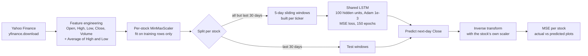

# Stock Market Prediction with LSTM

A PyTorch LSTM that predicts next-day closing prices for Apple (AAPL), Microsoft (MSFT), Amazon (AMZN) and Tesla (TSLA) from five days of OHLCV history, evaluated on a held-out final 30 trading days per stock and compared against a naive "tomorrow equals today" baseline.

[](https://colab.research.google.com/github/Sagargupta16/stock-market-prediction/blob/main/SMP.ipynb)
[](https://github.com/Sagargupta16/stock-market-prediction/actions/workflows/ci.yml)

## Project Overview

The whole project is one notebook, [`SMP.ipynb`](SMP.ipynb), that runs top to bottom in Google Colab or local Jupyter. It pulls 2020-01-01 to 2023-01-01 daily bars from Yahoo Finance, trains one shared LSTM on all four tickers, and reports per-stock error on data the model never saw during training.

### Key Features

- **Multi-stock training**: one shared LSTM learns from all four tickers; each ticker keeps its own scaler so predictions map back to real dollar prices
- **LSTM neural network**: `nn.LSTM` with 100 hidden units and a linear head, written from scratch in PyTorch
- **Live data fetching**: daily bars pulled from Yahoo Finance via `yfinance` at run time; nothing is cached in the repo
- **Leak-free evaluation**: the last 30 trading days of each stock are held out from both training sequences and scaler fitting
- **Visualization**: actual vs predicted price charts per stock, plus 20-day and 50-day simple moving averages
- **Performance metrics**: Mean Squared Error per stock in dollars squared

## Architecture



### LSTM Network Structure

- **Input**: 6 features per day (Open, High, Low, Close, Volume, Average)
- **LSTM layer**: 100 hidden units, single layer
- **Output layer**: linear, 1 unit (next-day scaled Close)
- **Sequence length**: 5 trading days
- **Optimizer**: Adam, learning rate 0.001
- **Loss**: Mean Squared Error

### Data Processing Pipeline

1. **Fetch**: daily bars for each ticker from Yahoo Finance (2020-01-01 to 2023-01-01, about 756 trading days each)
2. **Feature engineering**: add `Average = (High + Low) / 2`
3. **Normalize**: one `MinMaxScaler` per stock, fit on the training rows only
4. **Hold out**: the last 30 trading days of each stock are the test set
5. **Sequence**: 5-day sliding windows built separately per ticker, so no window mixes two stocks
6. **Train**: one shared model on the training windows of all four stocks
7. **Evaluate**: predict the 30 test days per stock, inverse-transform with that stock's scaler, report MSE

## Results

One full run of the notebook on 2026-10-18 (150 epochs, CPU, no fixed seed), scored on the held-out last 30 trading days of 2022. MSE is in dollars squared; RMSE is its square root in dollars.

| Stock | LSTM MSE | Naive MSE | LSTM RMSE | Naive RMSE |
| --- | ---: | ---: | ---: | ---: |
| AAPL | 18.46 | 7.75 | $4.30 | $2.78 |
| MSFT | 26.22 | 19.08 | $5.12 | $4.37 |
| AMZN | 101.11 | 3.55 | $10.06 | $1.89 |
| TSLA | 98.90 | 54.02 | $9.94 | $7.35 |

**Naive** predicts each day's close as the previous day's close. On this test window it beats the LSTM on all four stocks. That matches the forecasting literature: daily stock prices are close to a random walk, so last close is a hard baseline to beat, and this repo is a worked example of measuring that honestly rather than a trading signal. AMZN does worst, likely partly because 3 of its 30 test closes fall below its training range, so the model has to extrapolate.

Before 1.3.0 the notebook trained on the same 30 days it was scored on, so earlier MSE figures from this repo were not out-of-sample.

## Getting Started

### Run in Colab (no setup)

Click the **Open In Colab** badge above, then **Runtime > Run all**.

### Run locally

Requires Python 3.14 (pinned in [`.python-version`](.python-version)).

1. Clone the repository:

```bash
git clone https://github.com/Sagargupta16/stock-market-prediction.git
cd stock-market-prediction
```

2. Install the pinned dependencies (with [uv](https://docs.astral.sh/uv/), or plain `pip install -r requirements.txt`):

```bash
uv venv
uv pip install -r requirements.txt
```

3. Open the notebook and run all cells:

```bash
uv run jupyter notebook SMP.ipynb
```

Or execute it headless:

```bash
uv run jupyter nbconvert --to notebook --execute --ExecutePreprocessor.timeout=7200 --output executed.ipynb SMP.ipynb
```

## Usage

### Running the Prediction Model

1. **Data preparation**:

```python
# Fetch and preprocess stock data, holding out the last N days from the scaler fit
N = 30
data_aapl, scaler_aapl = fetch_preprocess('AAPL', '2020-01-01', '2023-01-01', N)
```

2. **Model training**:

```python
# Train the LSTM model on per-stock windows that exclude the test days
model = LSTM()
# Training loop with 150 epochs
```

3. **Prediction and evaluation**:

```python
# Evaluate on the held-out test window
actual_prices, predicted_prices = evaluate_model(test_sequences_aapl, scaler_aapl, model, 'AAPL')
```

### Customization Options

- **Stock symbols**: change the tickers passed to `fetch_preprocess`
- **Date range**: adjust the start and end dates
- **Test window**: change `N` (trading days held out per stock)
- **Model parameters**: tune hidden size, sequence length and learning rate
- **Training epochs**: change `epochs` in the training cell

## Project Structure

```text
stock-market-prediction/
├── SMP.ipynb                 # Notebook: data fetch, model, training, evaluation, plots
├── requirements.txt          # Pinned Python dependencies (Renovate keeps them current)
├── .python-version           # Python 3.14
├── .github/workflows/ci.yml  # CI: binary-only install + notebook code compile check
├── README.md                 # Project documentation
├── CHANGELOG.md              # Release history
├── SECURITY.md               # Security policy
└── LICENSE                   # MIT license
```

## Technical Details

### Dependencies

- **PyTorch**: LSTM model and training loop
- **yfinance**: Yahoo Finance data download
- **pandas**: tabular data handling
- **scikit-learn**: `MinMaxScaler` and `mean_squared_error`
- **matplotlib**: plots
- **numpy**: array work for inverse scaling
- **jupyter**: notebook runtime

### Design Decisions

- **One shared model, per-stock scalers**: four tickers give the LSTM about 4x more training windows than any single stock, while separate scalers keep an $84 AMZN close and a $233 MSFT close on the same 0 to 1 range and let each prediction map back to its own dollar scale.
- **Scaler fit on training rows only**: fitting min/max on the full series would leak the test window's price range into training. In this date range AMZN's lowest closes fall inside the last 30 days, so the leak is not hypothetical.
- **Per-ticker windows**: building windows on the concatenated series would create windows that start in one stock and end in the next.
- **Naive baseline**: for daily stock prices, predicting tomorrow's close as today's close is a strong benchmark ([Hyndman and Athanasopoulos, FPP3, section 5.2](https://otexts.com/fpp3/simple-methods.html)), so every result is reported next to it.

### Model Training Process

1. **Normalize** every feature to the [0, 1] range of its training rows
2. **Build** overlapping 5-day windows per ticker
3. **Train** one window at a time (no mini-batching), resetting the LSTM hidden state before each window
4. **Optimize** with Adam on MSE loss for 150 epochs

## Limitations

- Training processes one window per step with no batching; 150 epochs took about 70 minutes on a laptop CPU in the 2026-10-18 run. A GPU Colab runtime or mini-batching is much faster.
- The LSTM does not beat the naive baseline on the current test window (see Results).
- MSE is in dollars squared and comes from a single training run with no fixed seed, so numbers move between runs.
- The model is never saved; it lives only in the notebook session.
- The last chart ("Illustrative Feature Weights") uses hand-entered placeholder values, not values computed from the model.
- The moving-average charts are drawn on min-max scaled prices.

## Contributing

Contributions are welcome! Please feel free to submit a Pull Request. For major changes, please open an issue first to discuss what you would like to change.

### Areas for Improvement

- Integration of additional technical indicators
- Implementation of other neural network architectures (GRU, Transformer)
- Portfolio optimization features
- Real-time prediction API
- Enhanced visualization dashboard

## License

This project is open source and available under the [MIT License](LICENSE).

## Contact

**Sagar Gupta** - [GitHub Profile](https://github.com/Sagargupta16)

Project Link: [https://github.com/Sagargupta16/stock-market-prediction](https://github.com/Sagargupta16/stock-market-prediction)

## Disclaimer

This project is for educational and research purposes only. The predictions made by this model should not be considered as financial advice. Always consult with a qualified financial advisor before making investment decisions. Past performance does not guarantee future results.

## Acknowledgments

- Yahoo Finance for providing free access to historical stock data
- PyTorch community for excellent deep learning framework
- Financial data science community for inspiration and best practices
