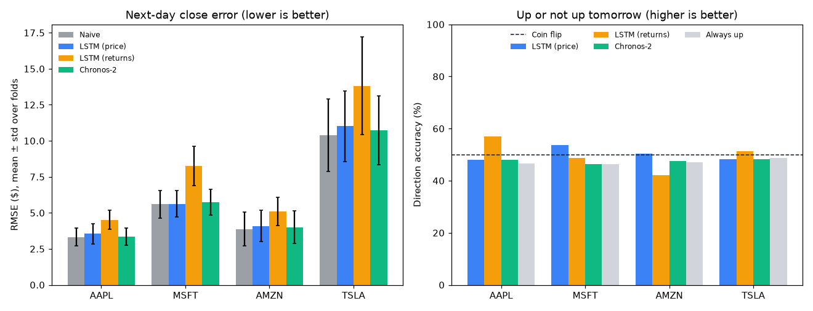
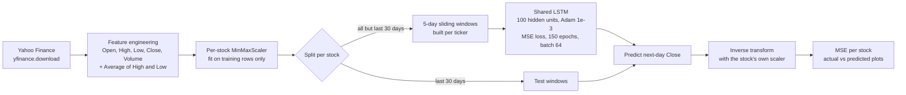
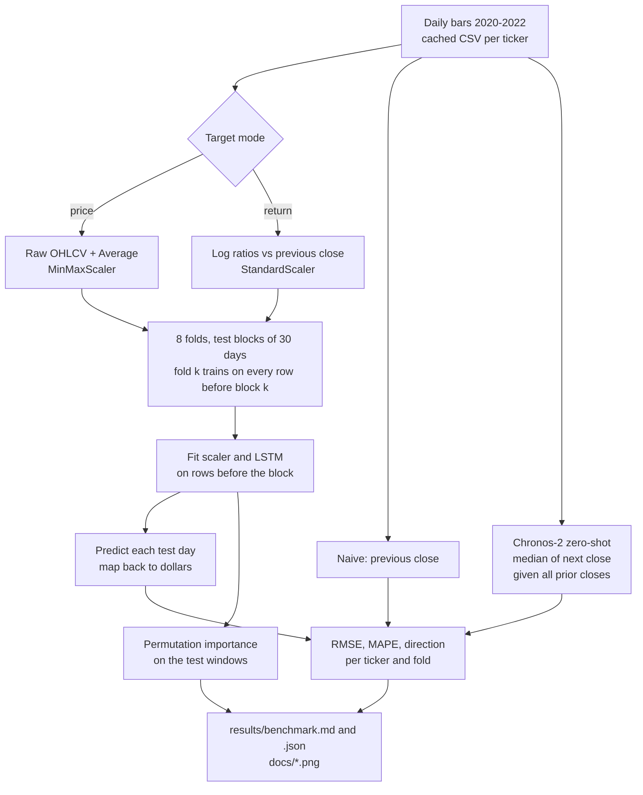
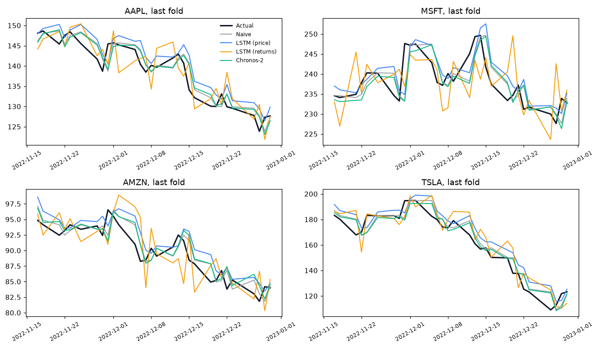
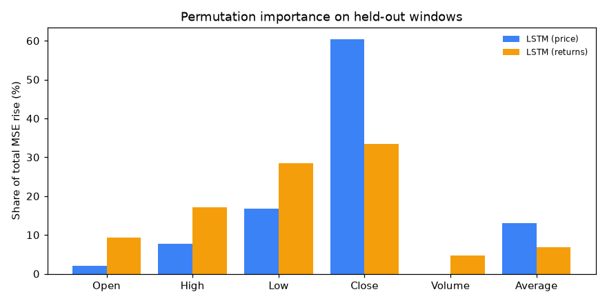

# Stock Market Prediction with LSTM

A PyTorch LSTM that predicts next-day closing prices for Apple (AAPL), Microsoft (MSFT), Amazon (AMZN) and Tesla (TSLA) from five days of OHLCV history, then a walk-forward benchmark that asks the honest question: does it beat "tomorrow equals today"? It is scored against that naive baseline, an LSTM trained on log returns, and Amazon's zero-shot Chronos-2 foundation model on 8 rolling 30-day test windows across 2022.

Short answer: no. Naive has the lowest mean error on all four stocks, and no model calls tomorrow's direction much better than a coin flip.

[](https://colab.research.google.com/github/Sagargupta16/stock-market-prediction/blob/main/SMP.ipynb)
[](https://github.com/Sagargupta16/stock-market-prediction/actions/workflows/ci.yml)



| Model (all 4 stocks, 8 folds) | RMSE ($) | MAPE | Direction accuracy | Stock-folds beating naive |
| --- | ---: | ---: | ---: | ---: |
| Naive (previous close) | 5.79 ± 3.16 | 2.27 ± 0.75% | n/a | - |
| LSTM, price target | 6.07 ± 3.31 | 2.44 ± 0.91% | 50.1 ± 7.2% | 9 of 32 |
| LSTM, log-return target | 7.92 ± 4.17 | 3.20 ± 0.99% | 49.8 ± 9.2% | 0 of 32 |
| Chronos-2 (zero-shot) | 5.95 ± 3.24 | 2.37 ± 0.77% | 47.5 ± 8.4% | 7 of 32 |
| Always up | - | - | 47.2 ± 7.0% | - |

Measured by `python -m smp.benchmark` on 2026-10-18; per-stock tables are in [results/benchmark.md](results/benchmark.md).

## Project Overview

The project has two parts that share one pipeline:

- [`SMP.ipynb`](SMP.ipynb): the original notebook. It runs top to bottom in Google Colab or local Jupyter, trains one shared LSTM on 2020-01-01 to 2023-01-01 daily bars, and scores the last 30 trading days per stock against the naive baseline. Self-contained, so the Colab badge works without cloning.
- [`smp/`](smp): the same pipeline as a tested Python package plus the walk-forward benchmark. It adds rolling-origin evaluation, a log-return target, a Chronos-2 zero-shot baseline, direction accuracy and permutation importance, and writes its tables and charts to [`results/`](results) and [`docs/`](docs).

### Key Features

- **Walk-forward evaluation**: 8 expanding-window folds of 30 trading days per stock; every fold retrains from scratch on data strictly before its test block
- **Four forecasters on the same days**: naive previous close, LSTM on price, LSTM on log returns, and zero-shot [Chronos-2](https://github.com/amazon-science/chronos-forecasting)
- **Three metrics**: RMSE in dollars, MAPE, and direction accuracy against coin-flip and always-up baselines
- **Permutation importance**: computed on held-out windows, in both the notebook and the benchmark
- **Multi-stock training**: one shared LSTM learns from all four tickers; each ticker keeps its own scaler so predictions map back to real dollar prices
- **Leak-free by construction**: scalers fit on training rows only, windows built per ticker, and unit tests that fail if a test row reaches training
- **Fast and reproducible**: seeded mini-batch training (batch 64) that uses a GPU when present; the full notebook runs in about 3 minutes on a laptop CPU
- **Live data fetching**: daily bars pulled from Yahoo Finance via `yfinance`; the benchmark caches them locally so reruns score identical data

## Architecture



### Walk-forward benchmark



### LSTM Network Structure

- **Input**: 6 features per day (Open, High, Low, Close, Volume, Average)
- **LSTM layer**: 100 hidden units, single layer
- **Output layer**: linear, 1 unit (next-day scaled Close, or next-day scaled log return in the return mode)
- **Sequence length**: 5 trading days
- **Optimizer**: Adam, learning rate 0.001
- **Loss**: Mean Squared Error

### Data Processing Pipeline

1. **Fetch**: daily bars for each ticker from Yahoo Finance (2020-01-01 to 2023-01-01, about 756 trading days each)
2. **Feature engineering**: add `Average = (High + Low) / 2`
3. **Normalize**: one `MinMaxScaler` per stock, fit on the training rows only
4. **Hold out**: the last 30 trading days of each stock are the test set
5. **Sequence**: 5-day sliding windows built separately per ticker, so no window mixes two stocks
6. **Train**: one shared model on the training windows of all four stocks
7. **Evaluate**: predict the 30 test days per stock, inverse-transform with that stock's scaler, report MSE

## Results

### Walk-forward benchmark

8 folds x 4 stocks = 32 test blocks of 30 trading days, 2022-01-19 to 2022-12-30. Each LSTM is retrained per fold for 150 epochs with seed `0 + fold`. Values are mean ± std across folds. Full tables, including MAPE, are in [results/benchmark.md](results/benchmark.md).

RMSE in dollars, lower is better:

| Stock | Naive | LSTM (price) | LSTM (returns) | Chronos-2 |
| --- | ---: | ---: | ---: | ---: |
| AAPL | 3.32 ± 0.63 | 3.55 ± 0.69 | 4.51 ± 0.66 | 3.34 ± 0.59 |
| MSFT | 5.60 ± 0.97 | 5.62 ± 0.91 | 8.25 ± 1.35 | 5.73 ± 0.91 |
| AMZN | 3.88 ± 1.16 | 4.09 ± 1.09 | 5.09 ± 0.99 | 4.01 ± 1.14 |
| TSLA | 10.37 ± 2.51 | 11.01 ± 2.46 | 13.82 ± 3.40 | 10.73 ± 2.40 |

Direction accuracy, percent of days where "up or not up tomorrow" was called right:

| Stock | LSTM (price) | LSTM (returns) | Chronos-2 | Always up |
| --- | ---: | ---: | ---: | ---: |
| AAPL | 47.9 ± 5.6% | 57.1 ± 4.5% | 47.9 ± 5.9% | 46.7 ± 6.4% |
| MSFT | 53.8 ± 4.2% | 48.8 ± 9.4% | 46.2 ± 7.0% | 46.2 ± 4.9% |
| AMZN | 50.4 ± 9.7% | 42.1 ± 7.1% | 47.5 ± 10.4% | 47.1 ± 7.4% |
| TSLA | 48.3 ± 7.8% | 51.2 ± 9.1% | 48.3 ± 11.0% | 48.7 ± 9.7% |

What the numbers say:

- **Naive wins on level.** It has the lowest mean RMSE on every stock. The price LSTM beats it in 9 of 32 stock-folds and Chronos-2 in 7, but neither wins on average. Daily closes are close to a random walk, so yesterday's close is the forecast to beat ([Hyndman and Athanasopoulos, FPP3, section 5.2](https://otexts.com/fpp3/simple-methods.html)).
- **The price LSTM mostly copies the last close.** Shuffling the Close column accounts for 60.4% of the total rise in test error under permutation importance; shuffling Volume changes nothing measurable. In the last-fold chart below its line runs alongside naive's, one day behind the actual close.
- **Predicting returns does not find a signal.** The return-target LSTM is worst on RMSE after 150 epochs (7.92 vs 5.79 overall), which is overfitting noise. Trained for only 5 epochs it lands at 5.85 ([results/epochs-5/benchmark.md](results/epochs-5/benchmark.md)), within 0.06 of naive: the less it learns, the closer it gets to predicting zero change.
- **Direction is a coin flip.** Every model sits between 47.5% and 50.1% overall with fold-to-fold spreads of 7 to 9 points. With 30 days per fold, the 57.1% on AAPL is about 17 correct calls out of 30 and is not evidence of skill on its own.
- **Chronos-2 is the best non-naive model overall, with zero training.** It is closest to naive on AAPL, AMZN and TSLA (the price LSTM edges it on MSFT) without a single gradient step on this data. Its pretraining data may include public prices from 2022, so treat its row as optimistic.





### Notebook run

The notebook scores one window, the last 30 trading days of 2022, with a single seeded model. Headless run on 2026-10-18 (150 epochs, batch 64, laptop CPU). MSE is in dollars squared; RMSE is its square root in dollars.

| Stock | LSTM MSE | Naive MSE | LSTM RMSE | Naive RMSE |
| --- | ---: | ---: | ---: | ---: |
| AAPL | 8.66 | 7.75 | $2.94 | $2.78 |
| MSFT | 19.56 | 19.08 | $4.42 | $4.37 |
| AMZN | 3.97 | 3.55 | $1.99 | $1.89 |
| TSLA | 54.51 | 54.02 | $7.38 | $7.35 |

Naive beats the LSTM on all four stocks here too, which matches the last fold of the benchmark.

Before 1.3.0 the notebook trained on the same 30 days it was scored on, so earlier MSE figures from this repo were not out-of-sample.

## Getting Started

### Run in Colab (no setup)

Click the **Open In Colab** badge above, then **Runtime > Run all**. A GPU runtime is optional; the notebook picks it up automatically.

### Run locally

Requires Python 3.14 (pinned in [`.python-version`](.python-version)).

1. Clone the repository:

```bash
git clone https://github.com/Sagargupta16/stock-market-prediction.git
cd stock-market-prediction
```

2. Install the pinned dependencies (with [uv](https://docs.astral.sh/uv/), or plain `pip install -r requirements.txt`):

```bash
uv venv
uv pip install -r requirements.txt
```

3. Open the notebook and run all cells:

```bash
uv run jupyter notebook SMP.ipynb
```

Or execute it headless (about 3 minutes on a laptop CPU):

```bash
uv run jupyter nbconvert --to notebook --execute --output executed.ipynb SMP.ipynb
```

### Run the benchmark

```bash
uv run python -m smp.benchmark                # full run: 8 folds, 150 epochs, Chronos-2
uv run python -m smp.benchmark --no-chronos   # skip the Chronos-2 model download
uv run python -m smp.benchmark --end today    # score the most recent data instead of 2020-2022
```

The first run downloads the bars into `data/cache/` (gitignored) and the `amazon/chronos-2` weights from Hugging Face. It writes `results/benchmark.json`, `results/benchmark.md` and the three charts in `docs/`. The committed results took 634 s (price LSTM), 809 s (return LSTM) and 121 s (Chronos-2) on a laptop CPU, as recorded in the results file. To redraw the tables and charts from a saved run without retraining:

```bash
uv run python -m smp.benchmark --from-json results/benchmark.json
```

### Run the tests

```bash
uv run python -m pytest -q
```

The tests run offline on synthetic random walks. They check that scalers ignore test rows, that no training window reaches its label row or the test block, that scaling round-trips to the real close in both target modes, the metrics, permutation importance, seeded training, and one end-to-end benchmark run.

## Usage

### Running the Prediction Model

1. **Data preparation**:

```python
# Fetch and preprocess stock data, holding out the last N days from the scaler fit
N = 30
data_aapl, scaler_aapl = fetch_preprocess('AAPL', '2020-01-01', '2023-01-01', N)
```

2. **Model training**:

```python
# Train the LSTM model on per-stock windows that exclude the test days
model = LSTM().to(device)
# Mini-batch training loop: 150 epochs, batch size 64
```

3. **Prediction and evaluation**:

```python
# Evaluate on the held-out test window
actual_prices, predicted_prices = evaluate_model(test_sequences_aapl, scaler_aapl, model, 'AAPL')
```

### Using the package

```python
from smp.data import build_features, load_ohlcv
from smp.evaluate import prepare_fold, score, to_price
from smp.model import predict, train_lstm

s = build_features(load_ohlcv("AAPL", "2020-01-01", "2023-01-01"), "price", "AAPL")
fold = prepare_fold(s, test_start=len(s.close) - 30, test_days=30, seq_len=5, target="price")
model = train_lstm(fold.x_train, fold.y_train, epochs=150)
pred = to_price(predict(model, fold.x_test), fold.scaler, s, fold.test_rows, "price")
print(score(s.close[fold.test_rows], pred, s.prev_close[fold.test_rows]))
```

### Customization Options

- **Stock symbols**: change the tickers passed to `fetch_preprocess`, or `--tickers` on the benchmark
- **Date range**: adjust the start and end dates, or `--start` and `--end` (`--end today` for live data)
- **Test window**: change `N` (trading days held out per stock), or `--test-days` and `--folds`
- **Model parameters**: tune hidden size, sequence length and learning rate
- **Training epochs**: change `epochs` in the training cell, or `--epochs`

## Project Structure

```text
stock-market-prediction/
├── SMP.ipynb                 # Notebook: data fetch, model, training, evaluation, plots
├── smp/
│   ├── data.py               # yfinance download with CSV cache, price and log-return features
│   ├── evaluate.py           # Walk-forward folds, leak-free scaling, windows, metrics
│   ├── model.py              # LSTM, seeded mini-batch training, GPU pick
│   ├── importance.py         # Permutation importance
│   ├── chronos_baseline.py   # Chronos-2 zero-shot next-day forecast
│   └── benchmark.py          # CLI: python -m smp.benchmark
├── tests/test_pipeline.py    # Offline pytest suite
├── results/                  # Committed benchmark output (JSON + Markdown tables)
├── docs/                     # Benchmark charts used in this README
├── requirements.in           # Direct dependency pins (Renovate keeps them current)
├── requirements.txt          # Hash-locked full dependency set, generated from requirements.in by uv
├── .python-version           # Python 3.14
├── .github/workflows/ci.yml  # CI: hash-checked binary-only install, notebook compile, pytest
├── README.md                 # Project documentation
├── CHANGELOG.md              # Release history
├── SECURITY.md               # Security policy
└── LICENSE                   # MIT license
```

## Technical Details

### Dependencies

- **PyTorch**: LSTM model and training loop
- **yfinance**: Yahoo Finance data download
- **pandas**: tabular data handling
- **scikit-learn**: `MinMaxScaler`, `StandardScaler` and `mean_squared_error`
- **matplotlib**: plots
- **numpy**: array work for inverse scaling
- **chronos-forecasting**: Chronos-2 zero-shot baseline
- **pytest**: test suite
- **jupyter**: notebook runtime

### Design Decisions

- **One shared model, per-stock scalers**: four tickers give the LSTM about 4x more training windows than any single stock, while separate scalers keep an $84 AMZN close and a $233 MSFT close on the same 0 to 1 range and let each prediction map back to its own dollar scale.
- **Scaler fit on training rows only**: fitting min/max on the full series would leak the test window's price range into training. In this date range AMZN's lowest closes fall inside the last 30 days, so the leak is not hypothetical.
- **Per-ticker windows**: building windows on the concatenated series would create windows that start in one stock and end in the next.
- **Naive baseline**: for daily stock prices, predicting tomorrow's close as today's close is a strong benchmark ([Hyndman and Athanasopoulos, FPP3, section 5.2](https://otexts.com/fpp3/simple-methods.html)), so every result is reported next to it.
- **Walk-forward, not one split**: one 30-day window is a single noisy draw. Eight expanding folds give a mean and a spread, and each fold only trains on its past.
- **Return target as a second model**: a price-level target lets the network score well by copying the last close. Log returns remove that shortcut, so any skill has to show up as a better-than-zero return forecast or a better-than-coin direction call.
- **Always up as the direction baseline**: naive predicts no change, so it never calls a direction. Always up is the simplest rule that does; 2022 was a down year, so it scores below 50%.
- **Same scored days for every model**: both target modes drop the first raw row, so all four forecasters are scored on exactly the same 960 stock-days.

### Model Training Process

1. **Normalize** every feature to the [0, 1] range of its training rows
2. **Build** overlapping 5-day windows per ticker
3. **Train** in shuffled mini-batches of 64 windows; the LSTM hidden state starts at zero for each window
4. **Optimize** with Adam on MSE loss for 150 epochs, with a fixed seed

## Limitations

- No model here beats the naive baseline on average (see Results). This is an evaluation study, not a trading signal.
- The return-target LSTM uses the same 150 epochs as the price model with no early stopping or regularisation, and it overfits.
- Test windows cover 2022 only, when all four stocks fell (AAPL -28.2%, MSFT -27.7%, AMZN -50.7%, TSLA -69.2% first to last close). Use `--start` and `--end` to test other periods.
- Chronos-2 is evaluated zero-shot and its pretraining corpus may overlap the test period.
- MSE and RMSE are in dollars, so they are not comparable across stocks; MAPE is.
- The model is never saved; it lives only in the notebook session or benchmark process.
- The moving-average charts are drawn on min-max scaled prices.

## Contributing

Contributions are welcome! Please feel free to submit a Pull Request. For major changes, please open an issue first to discuss what you would like to change.

### Areas for Improvement

- Integration of additional technical indicators
- Implementation of other neural network architectures (GRU, Transformer)
- Portfolio optimization features
- Real-time prediction API
- Enhanced visualization dashboard

## License

This project is open source and available under the [MIT License](LICENSE).

## Contact

**Sagar Gupta** - [GitHub Profile](https://github.com/Sagargupta16)

Project Link: [https://github.com/Sagargupta16/stock-market-prediction](https://github.com/Sagargupta16/stock-market-prediction)

## Disclaimer

This project is for educational and research purposes only. The predictions made by this model should not be considered as financial advice. Always consult with a qualified financial advisor before making investment decisions. Past performance does not guarantee future results.

## Acknowledgments

- Yahoo Finance for providing free access to historical stock data
- PyTorch community for excellent deep learning framework
- Amazon Science for the open Chronos-2 forecasting model
- Financial data science community for inspiration and best practices
